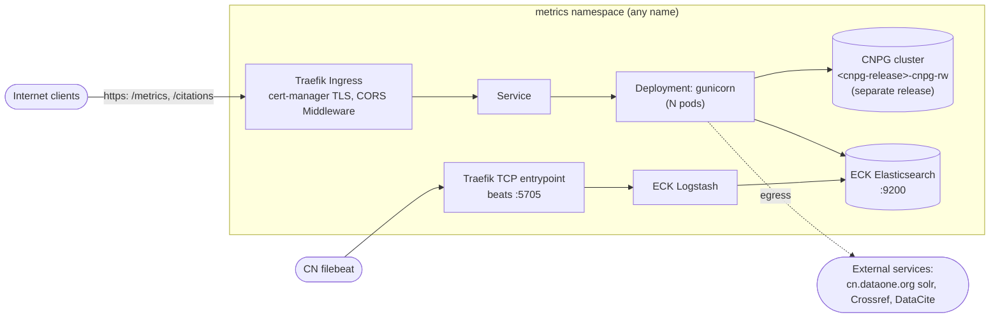
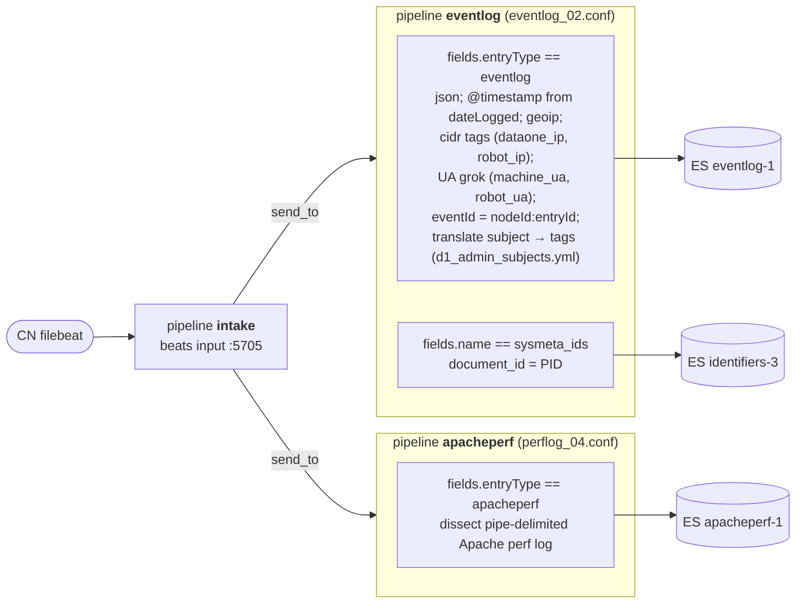

# Helm Chart Design: DataONE Metrics Service

Status: **DRAFT, revision 3** (incorporates review decisions of 2026-10-20). Nothing is implemented yet.

Host-specific and security-sensitive details are kept in a private companion document, not in
this repository.

This document plans how the metrics service is deployed to the DataONE `dev` and `prod` Kubernetes
clusters. It covers:

- which Kubernetes resources are needed and who owns each one;
- how the dependencies are put in place;
- how everything is configured through `values.yaml` and the per-environment override files;
- the order in which to build it.

It follows the conventions of [NCEAS/metacat](https://github.com/NCEAS/metacat/tree/develop/helm),
[DataONEorg/dataone-keycloak](https://github.com/DataONEorg/dataone-keycloak),
[DataONEorg/dataone-cnpg](https://github.com/DataONEorg/dataone-cnpg) and the
[k8s-cluster Traefik HOWTO](https://github.com/DataONEorg/k8s-cluster/blob/main/control-plane/ingress/traefik/traefik-HOWTO.md).

## Decisions so far

| # | Topic | Decision |
| --- | --- | --- |
| D1 | PostgreSQL | CNPG runs as a **separate Helm release** of `dataone-cnpg` in every environment, not as a subchart. The metrics chart has no subchart dependencies. |
| D2 | Apache | **Dropped.** We follow the simplest Traefik path in k8s-cluster: an Ingress plus one CORS `headers` Middleware, with TLS from cert-manager and gunicorn serving the app. Response caching is deferred (see TODO-2). |
| D3 | Elasticsearch | **In the cluster from the start**, managed by the **ECK operator**. The evaluation is in §2. |
| D4 | Hostnames | Production is `metrics.dataone.org` (the default) and dev is `metrics-dev.test.dataone.org` (override). Hostnames, TLS secret and issuer are all values. No name or namespace is hardcoded, so more deployments can go in other namespaces with other hostnames. |
| D5 | CN | A single `config.cnBaseUrl` value, defaulting to `https://cn.dataone.org/cn`. Every CN and solr URL in the code is derived from it. Dev changes it in its override file. |
| D6 | Production DB migration | `dataone-cnpg` `init.import` (`pg_dump`/`pg_restore`) from the current host database. |

## TODO list (tracked here until filed)

- **TODO-1, scheduled jobs.** Inventory the crontab and systemd units on the legacy production
  host. Then decide
  which jobs become CronJobs, and with what schedules and entry points. This covers at least:
  - session computation, the portal and eventlog sync, and the cache warm;
  - `getTargetCitationMetadata`;
  - materialized-view refresh;
  - DataCite reporting.

  The repository doesn't record what runs, or when.
- **TODO-2, caching.** File a GitHub issue to evaluate response caching for expensive `/metrics`
  queries, which Apache presumably did before. Include what the production vhost actually cached
  and for how long. Options to evaluate: no cache, an in-app cache, or a caching proxy.
- **TODO-3, ES licensing tier.** Confirm that the ECK and Elasticsearch features we use are all in
  the free Basic tier.
- **TODO-4, remaining ingest facts.** The live Logstash config is now captured (§2.1). Still to
  collect:
  - **The full CN filebeat input list:** which files carry which
    `fields.entryType`/`fields.name`, and whether more than one CN host ships.
  - **ES indices and aliases on the legacy cluster:** the code reads `identifiers-2`
    (`metricsreader.py:1432`, `pid_resolution.py:719`), but Logstash writes `identifiers-3`.
  - **Where `es_sysmeta_sync` (`d1sysmetaes`) runs:** its JSON output is what produces the
    `sysmeta_ids` events.
  - **The dictionaries Logstash loads from `/etc/dataone/metrics/`:** `dataone_ips.txt`,
    `robot_ips.txt` and `d1_admin_subjects.yml`. The repo has copies of the first two that may be
    stale. The third is not in the repo.

## 1. What we are deploying

The repository's `docker-compose.yaml` and `metrics.env` are historical (a bare postgres container),
and this design doesn't use them.

| Component | Today (production host) | In Kubernetes | Owner |
| --- | --- | --- | --- |
| REST API: `/metrics`, `/metrics/filters`, `/citations` (Falcon WSGI, `d1_metrics_service.app:application`) | Apache 2.4 + mod_wsgi | **Deployment** running gunicorn | this chart |
| Admin CLI and job code (`d1_metrics`: `d1metricsdb`, `d1metricses`, `d1sysmetaes`) | venv on host | the same image, run by Jobs and CronJobs | this chart |
| PostgreSQL `metrics` DB (tables, indexes, 7 materialized views) | host postgres | **CNPG `Cluster`** | separate `dataone-cnpg` release |
| Elasticsearch indexes `eventlog-1`, `identifiers-3`, `apacheperf-1` | ELK host, ES 6.x | **ECK `Elasticsearch`** | this chart (CR); ECK operator cluster-wide |
| Logstash ingest (beats on 5705; pipelines `intake` → `eventlog`, `apacheperf`; see §2.1) | ELK host, Logstash 6.x | **ECK `Logstash`** + a TCP entrypoint | this chart (CR) |
| TLS, CORS (Apache) | Apache | Traefik Ingress + `headers` Middleware + cert-manager | this chart |
| Periodic jobs | cron and `schedule` loops | **CronJobs** (TODO-1) | this chart |
| `d1_logagg`, and the filebeat agent(s) on the CN | CNs | unchanged; filebeat is repointed to the new Logstash | out of scope |



## 2. Elasticsearch evaluation (D3)

What we need is a maintained way to run Elasticsearch in the cluster that we can configure from
our own values, plus Logstash for ingest.

| Option | Status (checked 2026-10-20) | Assessment |
| --- | --- | --- |
| `elastic/helm-charts` (standalone `elasticsearch` and `logstash` charts) | **Archived** (April 2023, last version 8.5.1). Its README directs users to ECK. | Not viable: unmaintained, with no security updates. |
| Bitnami `elasticsearch` chart | Bitnami's free catalog was deprecated in August 2025. Images moved to `bitnamilegacy/` with no updates, or to a paid subscription. | Not viable, for the same reason metacat and others are moving off Bitnami dependencies. |
| Hand-written StatefulSet in this chart | n/a | Fine for one dev node. For a production cluster we would have to build discovery, TLS certificates, rolling upgrades and node replacement ourselves, which is what the operator already does. |
| OpenSearch (official chart, or operator v3.0) | Actively maintained | Viable on infrastructure, but it's a different product. We would have to port from `elasticsearch-py` to `opensearch-py`, and the stock Elastic filebeat and Logstash outputs don't target it. That adds risk, and the ES-version work below is needed anyway. |
| **ECK operator** (`elastic/cloud-on-k8s`, latest v3.5.0, Aug 2026) | Maintained by Elastic. CRs for `Elasticsearch`, `Kibana`, `Logstash` and `Beats`. | **Recommended.** |

**Why ECK.** It is the same operator-plus-CR model we already use with CNPG:

- an admin installs the operator once per cluster, documented in a new `k8s-cluster/operators/elastic`;
- each application chart renders a small CR, as `dataone-keycloak/templates/pg-cluster.yaml` does
  for postgres.

ECK also handles TLS, the bootstrap `elastic` user secret, rolling upgrades, PVCs per node set, and
Logstash with Elasticsearch connection references. The learning curve is real, but it is the same
kind we already climbed with CNPG. Keep the first CRs minimal:

- one `nodeSet` (1 node in dev, 3 in prod);
- the defaults for everything else;
- no Kibana.

**Consequence: an ES and client upgrade is now required (Stage 0).** The current ECK supports
**Elasticsearch 8.x and 9.x only**. ECK 3.0–3.2 also supported 7.17, and no ECK 3.x supports 6.x.
The service uses `elasticsearch>=6.8.2,<7` against an ES 6.x server, so:

- **Upgrade the code to `elasticsearch-py` 9.x and target the latest ES 9.x.** The work includes:
  - removing mapping types: `es_eventlog_sync.py` posts to `/<index>/_doc/<id>/_update`, and
    ES 6 bodies use `_type`;
  - moving from `body=` calls to the keyword API;
  - replacing the hardcoded `http://localhost:9200` URLs;
  - supporting authentication and TLS.

  **Why 9.x and not 8.x:** under Elastic's
  [EOL policy](https://www.elastic.co/support/eol), maintenance on 8.x (final minor 8.19) ends on
  15 January 2027 and support on 15 July 2027. That is only months after we would go live. 9.x is
  maintained until at least 15 October 2027, and the real date is 18 months after 10.0 ships,
  which is still to be announced.

  We reindex from 6.x either way (see below), so 9.x costs no extra migration step. Most of the
  code work is moving off the 6.x API, which we must do regardless. The 9.x client requires a 9.x
  server, and that's fine here because we install both together.
- **Migrate the data** for all three live indexes (§2.1), each into an index template for 9.x
  with typeless mappings, using **reindex-from-remote** from the 6.x production cluster:
  - `eventlog-1`;
  - `identifiers-3` (or whichever identifiers index is live; see TODO-4);
  - `apacheperf-1`, if anything still uses it.

  A 6.x snapshot can't be restored into a newer major.
  - Dev gets a bounded slice, for example the last 90 days, with the same mechanism.
  - Production gets the full index before cutover.
  - **Verify early (Stage 0):** that ES 9 accepts a 6.x cluster as a remote source, and that the
    source can be reached from the cluster. Only third-party guides confirm this so far. If it
    fails, the fallback is a small script that scrolls from 6.x and bulk-loads into 9.x.
- **Ingest:** Logstash 9.x runs the **live** pipelines (§2.1, not `search.conf`) with outputs
  pointed at the ECK cluster (ECK requires Logstash 8.7 or later). The CN filebeat then sends to
  the new endpoint. The CN currently runs a filebeat 6.x, which is past end of life, and no
  Elastic source we found confirms that it works with Logstash 9.
  - **Stage 3 test:** run a filebeat container of the same version as the CN against the dev
    Logstash.
  - **Plan: keep the current filebeat for now and upgrade it later, as its own step.** Production
    filebeat keeps shipping to the legacy Logstash until the Stage 5 cutover. Dev testing uses a
    filebeat container, so no CN changes are needed during development.
    - **If the Stage 3 test passes:** the cutover only repoints the existing filebeat output to the new beats
      endpoint. The CN filebeat upgrade to 9.x becomes a later, independent task.
    - **If it fails:** the upgrade to 9.x moves into the cutover, done in the same change window
      as the repointing.
    - Either way, the upgrade does not block the implementation stages.
    - **Watch the field names when filebeat is upgraded:** filebeat 7+ renames `beat.*` to
      `agent.*`/`host.*`. The eventlog pipeline reads the beat hostname field, so it must accept
      both field names before the upgrade.

### 2.1 Live ingest configuration

This was captured on 2026-10-20 from the legacy production host. The raw capture is kept privately.
It is the reference for the in-cluster pipelines. The repo's
`src/d1_search_metrics/conf/search.conf` (port 5704 with TLS, plus a "search" pipeline) and the
2018 `doc/source/architecture.rst` diagram, which shows a search.dataone.org shipper, are both
**obsolete**.



**Carry forward to the in-cluster Logstash:**
- **Pipelines:** `intake`, `eventlog` and `apacheperf`, as Logstash `pipelines` entries in the ECK
  `Logstash` CR. Their configs are kept in the chart under `config/logstash/`.
- **Outputs:** point them at the ECK cluster through `elasticsearchRefs`, with credentials, instead of
  the legacy local ES.
- **Remove `document_type => "_doc"`** from the `apacheperf` output, because ES 9 rejects mapping
  types.
- **Dictionaries:** mount the three dictionary files (TODO-4) from a ConfigMap at the same paths.
- **Access control:** the in-cluster beats endpoint is restricted to the CN source addresses with
  a Traefik `ipAllowList` on the TCP route (`ingest.allowedSourceRanges`), and uses TLS
  (`ingest.tls`, from `ingest.beatsTlsSecret`).
- **GeoIP:** the `geoip` filter in Logstash 9 downloads its database from Elastic by default, so the
  pods need egress to Elastic, or a mounted database.

**Leave behind:**
- `eventlog_00.conf`: a forwarder pipeline to a retired dev host. It is defined, but `intake` no
  longer sends to it.
- `eventlog_02.temp`, `eventlog_02_temp.conf` and `eventlog.20181217`: not referenced in
  `pipelines.yml`, so not loaded.
- `search.conf`: obsolete.

## 3. Code prerequisites (Stage 0)

These are separate PRs, and each also helps the host install.

1. **Configuration.** `MetricsReader`, `CitationsManager` and the jobs call `MetricsDatabase()` and
   `MetricsElasticSearch()` with no config file. They therefore always use `localhost` and an empty
   password.

   The fix: load `common.DEFAULT_CONFIG_FILE` (`/etc/dataone/metrics/database.ini`) when no file is
   passed, overridable with `METRICS_CONFIG_FILE`. Secrets come from environment variables that
   override the file:
   - `METRICS_DB_USER` and `METRICS_DB_PASSWORD`
   - `METRICS_ES_USER` and `METRICS_ES_PASSWORD`
   - `METRICS_DATACITE_TOKEN`
2. **One CN setting.** Add `cn_base_url`, defaulting to `https://cn.dataone.org/cn`. Derive
   `<cn>/v2/query/solr/`, `<cn>/v2/query` and `<cn>/v2/node/` from it, replacing the hardcoded
   `cn-secondary.dataone.org` and `cn.dataone.org` URLs in these modules:
   - `metricsreader`, `citationsmanager`, `metricsdatabase`
   - `metricsreporter`, `pid_resolution`
   - `metricscachehandler`, `es_eventlog_sync`

   Also remove the `dev_solr_url` and `cn_stage_solr_url` constants, and the
   `/var/local/metrics-service/localconfig.ini` path in `solrclient.py`.

   **Note:** the default changes from `cn-secondary` to `cn.dataone.org`.
3. **Logging.** Log to stdout instead of files: `cache.log`, `reports/reports.log`,
   `es_eventlog.log`, and gunicorn's `error.log` and `access.log`.
4. **Health route.** Add `GET /metrics/health`, which checks only that the process is up, for the
   probes.
5. **Job entry points.** Add one-shot console scripts in place of the `schedule` loops, as needed
   once TODO-1 is done.
6. **Elasticsearch 9 client** (§2).
7. **Container image.**
   - A `Dockerfile` with a current Python base image, a non-root user, gunicorn, both packages and
     `src/sql` at `/app/sql`.
   - A GitHub Action that publishes `ghcr.io/dataoneorg/metrics-service:<version>`.
   - The ES client upgrade makes this a good time to lift the other old pins (`aiohttp<3`,
     `falcon<2`, `regex<2022`) so that a supported Python works.

## 4. Repository layout

The chart lives at `helm/` in this repository, as metacat does. It is published to
`oci://ghcr.io/dataoneorg/charts/metrics-service`.

```text
helm/
  Chart.yaml                       # name: metrics-service; appVersion = image tag; no dependencies
  values.yaml                      # production-leaning defaults
  values-overrides-dev.yaml        # dev deltas
  values-overrides-prod.yaml       # prod deltas (only what differs from defaults)
  cnpg/
    values-overrides-cnpg-dev.yaml   # for the separate dataone-cnpg release (D1)
    values-overrides-cnpg-prod.yaml  # includes init.import from the host DB (D6)
  admin/
    secret--metrics-db.yaml        # basic-auth example (DO NOT COMMIT REAL VALUES)
    secret--metrics.yaml           # app secrets example
    secret--metrics-beats-tls.yaml # beats TLS example
  config/
    database.ini                   # rendered with tpl into the ConfigMap
    gunicorn.conf.py
    logstash/                      # intake.conf, eventlog.conf, apacheperf.conf + dictionaries (from §2.1)
  templates/
    _helpers.tpl                   # standard name/fullname/labels/selectorLabels/image helpers
    configmap.yaml
    deployment.yaml
    service.yaml
    ingress.yaml
    middleware-cors.yaml           # single Traefik headers Middleware (no chain needed)
    elasticsearch.yaml             # ECK Elasticsearch CR
    logstash.yaml                  # ECK Logstash CR + pipeline ConfigMap
    ingressroutetcp-beats.yaml     # Traefik TCP route for filebeat
    cronjobs.yaml                  # ranges over .Values.jobs (the one extensible template)
    job-db-init.yaml               # helm hook; empty DBs only
    NOTES.txt
    tests/test-connection.yaml
  README.md                        # install/upgrade, secrets, parameters table (@param)
  DESIGN.md                        # this document
```

Templates are plain, one resource per file. Only `cronjobs.yaml` is built to be extended: a new job
is a new values entry. `values-overrides-*.yaml`, `cnpg/`, `admin/` and `DESIGN.md` go in
`.helmignore`.

## 5. Kubernetes resources

All names derive from the release name, using `fullname` = `<release>-metrics-service`, or the
release name alone if it already contains the chart name. All resources go in the release
namespace. No namespace or hostname appears in a template.

| Resource | Owner | Notes |
| --- | --- | --- |
| `Deployment/<fullname>` | chart | gunicorn on port `http` 8000; `replicaCount` default 2; HTTP probes on `/metrics/health`. Non-root, `readOnlyRootFilesystem`, `emptyDir` at `/tmp`. A ConfigMap checksum annotation rolls the pods on config change. Mounts `database.ini` and `gunicorn.conf.py` at `/etc/dataone/metrics/`. Takes DB and ES credentials through `secretKeyRef`, and the app secret through `envFrom` |
| `Service/<fullname>` | chart | ClusterIP, port 80 → `http` |
| `Ingress/<fullname>` | chart | `ingressClassName` from values (`traefik`); cert-manager `cluster-issuer` annotation; host `ingress.hostname` plus `ingress.extraHosts` (the HOWTO's "host aliases" pattern); paths `/metrics` and `/citations` (Prefix); TLS secret default `<release>-metrics-tls`. Annotation `traefik.ingress.kubernetes.io/router.middlewares: <namespace>-<fullname>-cors@kubernetescrd`, built from `.Release.Namespace` |
| `Middleware/<fullname>-cors` | chart | Traefik `headers`, following k8s-cluster's `headers-middleware.yaml`. The origin, methods, headers and max-age come from `cors.*`, with defaults matching today's Apache config (`*`; GET, POST, PUT, DELETE, OPTIONS). Gated by `cors.enabled` |
| `ConfigMap/<fullname>-config` | chart | `database.ini` (non-secret settings only) and `gunicorn.conf.py` |
| `Elasticsearch/<fullname>-es` | chart (ECK reconciles it) | `version`, `nodeCount`, storage class and size, resources, `xpack.security` defaults. ECK creates the Services `<name>-es-http` and the Secrets `<name>-es-elastic-user` and `<name>-es-http-certs-public`. The app trusts the ECK CA from the certs secret. Gated by `elasticsearch.managed` (default `true`); when `false`, `elasticsearch.host` must point at an existing cluster |
| `Logstash/<fullname>-ls` | chart (ECK) | `elasticsearchRefs` to the ES CR; pipelines `intake`, `eventlog` and `apacheperf` from `config/logstash/` (§2.1); dictionaries from a ConfigMap; beats input on 5705 with TLS from `ingest.beatsTlsSecret` (`ingest.tls`). Gated by `ingest.enabled` |
| `IngressRouteTCP/<fullname>-beats` | chart | Traefik TCP route for 5705 to the Logstash service, with an `ipAllowList` middleware limited to the CN addresses (`ingest.allowedSourceRanges`); needs a TCP entrypoint on Traefik (cluster admin, see §8 Stage 1). The alternative is a `LoadBalancer` Service if k8s-cluster prefers. Gated by `ingest.enabled` |
| `CronJob/<fullname>-<key>` | chart | One per enabled `.Values.jobs` entry. Same image, config and secrets as the API. `concurrencyPolicy: Forbid`. Contents depend on TODO-1 |
| `Job/<fullname>-db-init` | chart (`post-install` hook) | `d1metricsdb initialize --sqlinit '/app/sql/0*.sql'`. The SQL is **not idempotent**, so it is gated by `dbInit.enabled` (default `false`) and used only on an empty dev DB. Production uses the D6 import |
| `Pod/<fullname>-test-connection` | chart (`helm test`) | `wget` `/metrics/health` through the Service |
| `Cluster/<cnpg-release>-cnpg` | **separate `dataone-cnpg` release** | DB `metrics`, owner `metrics`, `existingSecret: metrics-db`; backups enabled in prod. The app connects to `<cnpg-release>-cnpg-rw` |
| Secrets for the DB, the app and beats TLS | **created outside Helm** | §6 |
| TLS certificate secret | cert-manager | named by `ingress.tls.secretName` |

Not planned yet: HPA, PodDisruptionBudget, NetworkPolicy, Kibana, ServiceAccount
(`serviceAccount.create: false`). Each can be added later as a small, values-gated template.

## 6. Secrets

The chart never creates a secret and never takes a secret value. Values only *name* secrets. Each
secret-name value passes through `tpl`, so `"{{ .Release.Name }}-metrics-db"` is valid. Examples
are in `helm/admin/`, with the "DO NOT CHECK CREDENTIALS INTO GITHUB" header and an `envsubst`
recipe, as in metacat.

| Values key | Default | Type and keys | Created by | Used by |
| --- | --- | --- | --- | --- |
| `database.existingSecret` | `metrics-db` | `kubernetes.io/basic-auth`: `username`, `password` | admin (`kubectl apply`) | the CNPG release (`existingSecret`); app env `METRICS_DB_*` |
| `existingSecret` | `metrics-secrets` | Opaque: `METRICS_DATACITE_TOKEN` (more keys later, all optional) | admin | API and CronJobs (`envFrom`) |
| `elasticsearch.existingSecret` | `""` (empty means `<fullname>-es-elastic-user`) | key `elastic` | the ECK operator | app env `METRICS_ES_PASSWORD` |
| `ingest.beatsTlsSecret` | `metrics-beats-tls` | `kubernetes.io/tls` | admin, or cert-manager `Certificate` | Logstash beats input, only when `ingest.tls: true` |

Before production, create a least-privilege role and user for the API: read on `eventlog-*` and
the identifiers index, plus write for the jobs. Development may use ECK's generated `elastic` user.
ECK supports custom users through a file-realm secret, which is also admin-created and named in
`elasticsearch.existingSecret`.

## 7. Values

`values.yaml` holds working defaults that lean toward production, documented with `## @param`
comments for `readme-generator-for-helm`. The override files contain only what differs.

```yaml
## values.yaml (abridged)
global:
  storageClass: csi-cephfs-sc

image:
  repository: ghcr.io/dataoneorg/metrics-service
  tag: ""                                   # defaults to .Chart.AppVersion
  pullPolicy: IfNotPresent

replicaCount: 2
gunicorn: { workers: 4, threads: 8, timeout: 120 }
logLevel: INFO
resources: {}

existingSecret: metrics-secrets             # §6

config:                                     # → database.ini (non-secret)
  cnBaseUrl: https://cn.dataone.org/cn      # D5; all CN/solr URLs derived from this
  dataciteReportUrl: https://api.datacite.org/reports

database:
  existingSecret: metrics-db
  host: metricsdb-cnpg-rw                   # <cnpg-release>-cnpg-rw; FQDN if another namespace
  port: 5432
  dbName: metrics

elasticsearch:
  managed: true                             # render the ECK CR; false = use `host` below
  host: ""                                  # defaults to <fullname>-es-es-http when managed
  port: 9200
  scheme: https
  index: eventlog-1
  requestTimeout: 60
  existingSecret: ""                        # defaults to ECK's <fullname>-es-elastic-user
  version: "9.x.y"                          # pinned exact latest 9.x, chosen in Stage 0
  nodeCount: 3
  storage: { size: 200Gi }                  # storageClass from global
  resources: {}

ingest:
  enabled: true
  beatsTlsSecret: metrics-beats-tls
  port: 5705
  tls: true
  allowedSourceRanges: []                   # CN IPs; set in prod override

ingress:
  enabled: true
  className: traefik
  hostname: metrics.dataone.org             # D4
  extraHosts: []                            # aliases
  annotations:
    cert-manager.io/cluster-issuer: letsencrypt-prod
  tls:
    secretName: ""                          # defaults to <release>-metrics-tls

cors:
  enabled: true
  allowOriginListRegex: [".*"]
  allowMethods: [GET, POST, PUT, DELETE, OPTIONS]
  allowHeaders: [x-requested-with, Content-Type, origin, authorization, accept, client-security-token]
  maxAge: 1000

dbInit:
  enabled: false

jobs: {}                                    # filled in after TODO-1; entry shape:
#  esSessions:
#    enabled: true
#    schedule: "*/30 * * * *"
#    command: [d1metricses]
#    args: [compute]
#    resources: {}
```

```yaml
## values-overrides-dev.yaml
replicaCount: 1
config:
  cnBaseUrl: https://cn-stage.test.dataone.org/cn      # or as you choose at deploy time
database:
  host: metricsdb-cnpg-rw
elasticsearch:
  nodeCount: 1
  storage: { size: 20Gi }
global:
  storageClass: csi-cephfs-sc-ephemeral
ingress:
  hostname: metrics-dev.test.dataone.org
dbInit:
  enabled: true
```

```yaml
## values-overrides-prod.yaml
resources: { requests: { cpu: 500m, memory: 1Gi }, limits: { memory: 2Gi } }
elasticsearch:
  resources: { requests: { cpu: "2", memory: 8Gi }, limits: { memory: 8Gi } }
# jobs that write to external production services (e.g. DataCite reports) are enabled only here
```

**Rule for jobs:** a job that writes to a shared external production service, such as DataCite
report submission, defaults to `enabled: false` and is turned on only in
`values-overrides-prod.yaml`. This is the one deliberate exception to "defaults prefer
production". It prevents a dev install from submitting reports.

Installing dev, assuming the release `metrics` and the namespace `metrics`:

```shell
kubectl apply -n metrics -f my-secret--metrics-db.yaml -f my-secret--metrics.yaml -f my-secret--beats-tls.yaml
helm upgrade --install metricsdb -n metrics oci://ghcr.io/dataoneorg/charts/cnpg --version 1.3.1 \
     -f helm/cnpg/values-overrides-cnpg-dev.yaml
helm upgrade --install metrics -n metrics ./helm -f helm/values-overrides-dev.yaml
helm test metrics -n metrics
```

Another deployment in a different namespace uses the same commands with its own namespace, and an
override file that sets `ingress.hostname`, `database.host` and, if different, the secret names.

## 8. Stages

| Stage | Scope | Done when |
| --- | --- | --- |
| **0. Code readiness** | §3 items 1–7; choose the exact ES 9.x version; verify 6.x→9.x reindex-from-remote | The image runs locally (for example with docker run and a local postgres and ES 9) using only `database.ini` and env vars; the existing tests pass against ES 9 |
| **1. Cluster prerequisites** (cluster admins, `k8s-cluster` repo) | Install the ECK operator on dev and prod, documented in `operators/elastic/`; add a Traefik TCP entrypoint for beats (or approve a LoadBalancer Service); create the `metrics` namespaces | `kubectl get crd elasticsearches.elasticsearch.k8s.elastic.co` succeeds on both clusters |
| **2. Dev: chart + DB + ES + API** | `Chart.yaml`, helpers, ConfigMap, Deployment, Service, Ingress, CORS Middleware, ES CR, db-init Job, NOTES, `helm test`, README, `admin/` examples, `cnpg/values-overrides-cnpg-dev.yaml`; reindex a dev slice of `eventlog-1`, plus the identifiers index, from production ES; `helm lint` and `helm template` in CI | On `metrics-dev.test.dataone.org`, `GET /metrics?...` returns data from the dev ES, `POST /citations` stores a row in the dev DB, `helm test` passes, and scythe's opt-in integration tests (`SCYTHE_TEST_CITATIONS_URL`) pass against it |
| **3. Dev: ingest** | Logstash CR and pipeline ConfigMap, beats TLS secret, `IngressRouteTCP`; point a test filebeat container at it | New events appear in the dev `eventlog-1` |
| **4. Scheduled jobs** | **TODO-1** first, then `cronjobs.yaml` and the `jobs` entries, plus any one-shot entry points | Each job runs on dev, triggered manually with `kubectl create job --from=cronjob/...` and then on schedule |
| **5. Production** | least-privilege ES user (§6); `cnpg/values-overrides-cnpg-prod.yaml` with `init.import` from the host DB and backups; full reindex-from-remote of the live indexes (§2.1); `values-overrides-prod.yaml`; publish the chart to `ghcr.io/dataoneorg/charts`; cut over the CN filebeat to the new beats endpoint; DNS for `metrics.dataone.org`; repoint clients (search UI, MetacatUI, scythe default URL) | Responses match the legacy host for a saved sample of requests; events and jobs are flowing; the legacy host is retired |
| **Later** | TODO-2 caching; CN filebeat upgrade (if not done at cutover); PDB, NetworkPolicy, Kibana as needed | n/a |

## 9. Out of scope

- `d1_logagg` and the filebeat agents themselves (they are only reconfigured).
- Citation endpoint fixes #104, #105, #106 and #109.
- Monitoring and alerting beyond the probes.
